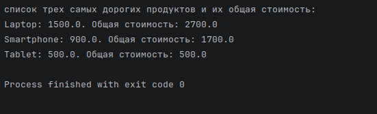

# itk.academy | Генерация чисел

## Задание

Предположим, у нас есть список заказов, и каждый заказ представляет собой продукт и его стоимость. 
Задача состоит в использовании Stream API и коллекторов для решения следующих задач:

1. Создайте список заказов с разными продуктами и их стоимостями.
2. Группируйте заказы по продуктам.
3. Для каждого продукта найдите общую стоимость всех заказов.
4. Отсортируйте продукты по убыванию общей стоимости.
5. Выберите три самых дорогих продукта.
6. Выведите результат: список трех самых дорогих продуктов и их общая стоимость.

## Результат

[Результат Кода](src/main/java/org.rkov.Main.java)

```java

List<Order> orders = List.of(
   new Order("Laptop", 1200.0),
   new Order("Smartphone", 800.0),
   new Order("Laptop", 1500.0),
   new Order("Tablet", 500.0),
   new Order("Smartphone", 900.0)
);
```


